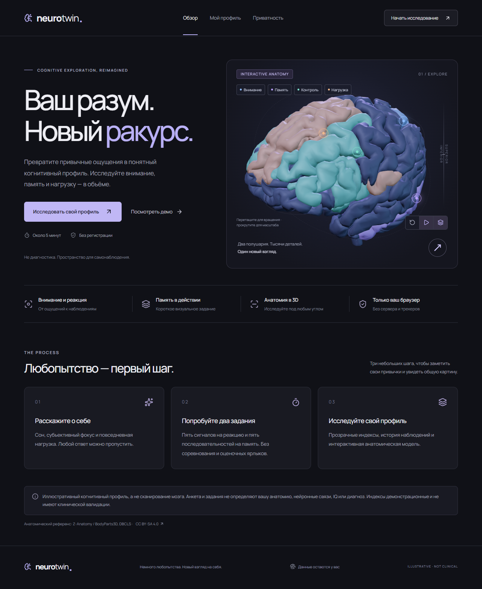
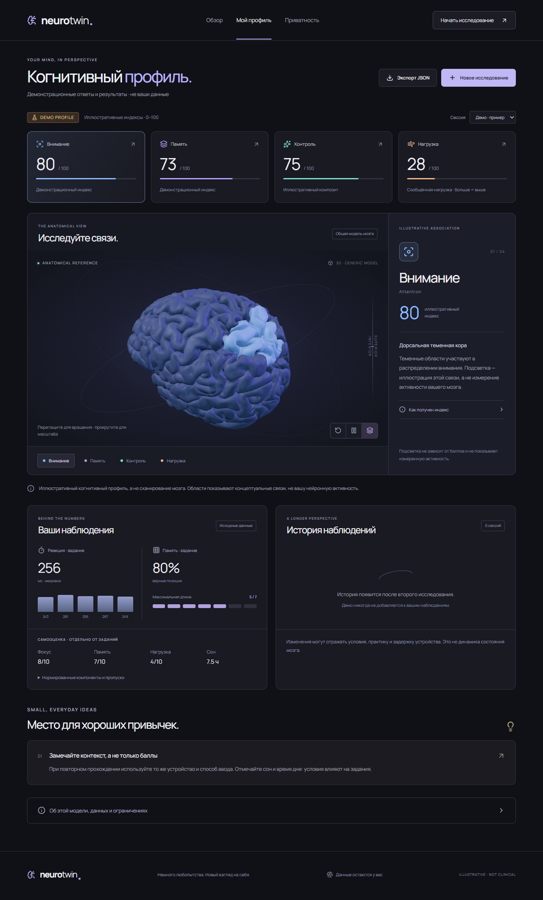

# NeuroTwin

Русскоязычный pet-проект для самонаблюдения: анкета, короткие задания на реакцию и визуальную память, прозрачный когнитивный профиль и настоящая анатомическая 3D-модель мозга.



## Запуск

Нужен Node.js 22.13+ (проверено на Node 24.14.1). Склонируйте репозиторий и установите зависимости:

```bash
git clone https://github.com/AdaiWard/NeuroTwin.git
cd NeuroTwin
npm ci
npm run dev
```

Открыть http://127.0.0.1:3000. Демо: http://127.0.0.1:3000/dashboard?demo=1.

```bash
npm run build
npm start
```

Команды проверки:

```bash
npm run typecheck
npm run lint
npm test
npm run test:e2e
```

GitHub Actions запускает lint, проверку типов, unit-тесты, production-сборку и браузерные сценарии при push в `main` и в pull request. `npm run typecheck` сначала генерирует типы Next.js, поэтому работает и в свежем клоне. Локальные `.env`-файлы исключены из Git; при необходимости скопируйте `.env.example` в `.env.local`.

Playwright использует установленный Google Chrome на Windows. На другой платформе задайте `PLAYWRIGHT_CHROME_PATH` или установите управляемый Chromium командой `npx playwright install chromium`. Дальнейшая настройка показана в `playwright.config.ts`. Тест сам поднимает dev-сервер или использует уже запущенный.

## Что работает

- `/`: главная с интерактивным анатомическим мозгом и демо-переходом.
- `/assessment`: необязательная анкета, пять корректных попыток реакции, пять последовательностей длиной 3–7, проверка результатов и создание профиля.
- `/dashboard`: четыре индекса, источник каждого результата, выбор области на поверхности или через доступные кнопки, плавная смена ракурса, история сессий и скачивание JSON.
- `/privacy`: описание локального хранения и удаление данных.
- Управление 3D: вращение мышью/пальцем, масштаб колесом/жестом, сброс ракурса, пауза вращения, переключение подсветки.
- Демо не сохраняется и не попадает в историю. До 20 пользовательских сессий хранятся отдельно.
- При недоступном WebGL или ошибке GLB отображается локальная 2D-анатомическая иллюстрация; информация об областях продолжает работать.



## Научные ограничения

Это **иллюстративный когнитивный профиль**, а не индивидуальный коннектом, MRI, диагностика, IQ или клинический прогноз. Анкета и браузерные задания не восстанавливают реальную анатомию, нейронные связи или активность. Индексы эвристические и не имеют клинической валидации.

Подсветка показывает приблизительные функциональные ассоциации на общем анатомическом референсе. Гиппокамп не изображается как видимый участок наружной коры. Нагрузка связана с концептуальной распределённой сетью и самоотчётом, а не с отдельным «органом стресса». Низкие значения не означают расстройство или повреждение мозга. Советы общие и недиагностические. ML для честного MVP не требуется.

## Стек и структура

Next.js App Router, React, строгий TypeScript, Three.js, React Three Fiber, Drei, Zustand, Lucide; обычный CSS с токенами. CSS выбран для точного контроля авторского интерфейса; backend, аккаунты и API-ключи не нужны. Установленные версии зафиксированы в `package-lock.json`. TypeScript 6 и ESLint 9 выбраны по совместимости с парсером и плагинами текущей конфигурации Next.js: TypeScript 7 не поддерживался её eslint-парсером.

```text
src/app/                         Маршруты и глобальные стили
src/components/brain/            3D-сцена, управление, резервная 2D-иллюстрация
src/components/assessment/       Реакция и последовательности
src/components/dashboard/        История и сравнение
src/lib/                        Формулы, валидация, рекомендации, демо
src/store/useNeuroStore.ts       Согласие, сохранение и удаление
src/types/neuro.ts               Общие типы
src/tests/                      Unit-тесты
e2e/                            Браузерные сценарии
public/models/                  Локальный GLB и лицензия
public/draco/                   Локальный декодер
public/fonts/                   Manrope и лицензия
```

## Анатомическая модель

Модель скачана из [Brain Project](https://github.com/itayinbarr/brainproject), содержит две половины коры, настоящие извилины и борозды, мозжечок и ствол. Файл `public/models/brain.glb` занимает 4.44 MiB и поставляется локально, без хотлинка. Используются тёмный жемчужный материал, мягкий ключевой свет, фиолетовый контровой свет и приглушённое заполнение. Метаданные позволяют подсвечивать настоящие поверхности, а маркеры привязаны к вершинам геометрии. Шкала баллов не меняет подсветку анатомии.

**© Z-Anatomy contributors and BodyParts3D / DBCLS. CC BY-SA 4.0.** Полная атрибуция, закреплённый commit, SHA-256 и условия перераспространения — в [ASSET_CREDITS.md](ASSET_CREDITS.md). GLB не изменён; новый визуальный стиль применяется при рендеринге. Собственный код MIT; лицензия кода не заменяет лицензию модели.

Чтобы заменить модель: сначала получите файл с разрешённой лицензией, сохраните его локально, обновите атрибуцию, затем адаптируйте извлечение метаданных, масштаб, центр и камеры в `BrainScene.tsx`. Исходный GLB использует мировые координаты человеческого тела: камера смотрит на нормализованный центр мозга. Узлы с несколькими материалами — группы, и `bx_label` / `bx_cat` / `bx_side` принадлежат родительскому узлу. Замена только файла без этой адаптации не гарантирует корректные маркеры.

## Формулы

Реализация: `src/lib/scoring.ts`. Все итоговые значения ограничены 0–100 и округляются один раз в конце; недостающие компоненты не выдумываются.

| Компонент                         | Формула                                                                          |
| --------------------------------- | -------------------------------------------------------------------------------- |
| Самооценка 1–10                   | `(x − 1) / 9 × 100`                                                              |
| Реакция                           | Медиана ровно пяти допустимых попыток; `clamp(100 × (600 − ms) / 420)`           |
| Память в задании                  | `100 × (0.6 × точность позиций + 0.4 × максимальная полностью верная длина / 7)` |
| Внимание                          | `0.45 × фокус + 0.55 × индекс реакции`                                           |
| Память                            | `0.35 × самооценка памяти + 0.65 × индекс задания`                               |
| Контроль: иллюстративный композит | `0.45 × внимание + 0.45 × память + 0.10 × активность − штраф нагрузки`           |
| Активность                        | Невысокая = 25, умеренная = 60, высокая = 100                                    |
| Штраф нагрузки                    | `10 × clamp((стресс − 5) / 5, 0, 1)`; отсутствующий ответ не даёт штрафа         |
| Компонент короткого сна           | `clamp(100 × (8 − часы сна) / 4)`                                                |
| Сообщённая нагрузка               | `0.75 × самооценка стресса + 0.25 × компонент короткого сна`                     |

180 и 600 мс — условные границы интерфейса, **не нормативы населения**. Большая нагрузка означает больше сообщённой нагрузки, а не лучший результат. При пропусках доступные веса делятся на свою сумму. Если компонентов нет, значение `null` отображается как «нет данных». Возраст не используется в формулах. Точность памяти учитывает все позиции во всех раундах; короткий успешный раунд не даёт полного индекса задания.

Время реакции измеряется `performance.now()` после фиксации визуального сигнала. Ранние и повторные нажатия не создают допустимых попыток. При смене вкладки незавершённая попытка/раунд сбрасывается. Длина задания, последовательность и текущий ввод контролируются раздельно; во время ответа нет подсказки решения.

## Данные и приватность

Данные сохраняются в `localStorage` только после явного согласия. Ключ — `neurotwin:v1`, `schemaVersion: 1`. Черновик хранит завершённые задания и текущий шаг; незавершённое задание начинается заново. При чтении значения проверяются, шаги исправляются, индексы пересчитываются; неизвестная версия/повреждённый JSON сбрасывают сохранение. При будущей несовместимой схеме следует добавить явную миграцию или повысить ключ/версию с документированным сбросом.

Приложение не отправляет ответы и результаты по сети, не использует трекеры и внешние runtime-сервисы. Ассеты и шрифт локальные. Телеметрия инструментария Next.js отключена в `.env.local`. Если localStorage недоступен или заполнен, показывается уведомление, а текущая сессия работает в памяти. Удаление сбрасывает разрешение, черновик и историю; скачанные JSON нужно удалять отдельно.

## Доступность и производительность

Все области доступны через клавиатурные кнопки; тест реакции поддерживает пробел, память — клавиши 1–9 и кнопки с подписями. Во время показа последовательности есть объявления для скринридера; это альтернативный способ взаимодействия, который может повлиять на сравнимость результата. Задания можно пропустить. Есть фокус-контуры, skip-link, подписанные поля и поддержка `prefers-reduced-motion`.

Сцена загружается только на клиенте; DPR ограничен 1.65. Нет тяжёлого постпроцессинга, удалённых HDRI, частиц или мнимой нейронной активности. Материалы освобождаются при размонтировании, Canvas управляет WebGL-контекстом. На медленных устройствах можно остановить вращение или пользоваться 2D-резервом и списком областей. Кинематические показатели FPS на физических телефонах не измерялись; Chrome-проверка мобильной ширины не заменяет испытание на реальном телефоне.

## Проверки и известные ограничения

Unit-тесты проверяют точные формулы, пропуски, крайние значения, отсутствие деления на ноль, медиану, фильтрацию сохранённых данных и переходы заданий. Браузерные тесты проходят анкету, ранние клики, все пять попыток реакции и пять раундов памяти, генерацию, повторное чтение хранения, удаление, демо, подсветку, экспорт, мобильную ширину и ошибку GLB. Скриншоты находятся в `screenshots/`. Подробные результаты: [VERIFICATION.md](VERIFICATION.md) — 16 unit-тестов и 6 браузерных сценариев прошли, lint / typecheck / build завершились успешно.

Задания чувствительны к задержке устройства, способу ввода, практике и усталости. Мини-тест памяти не измеряет память в целом; «контроль» не является тестом исполнительной функции. Сессии не синхронизируются между браузерами. Полного offline-кэширования оболочки/PWA нет: модель и декодер локальные, но для первого открытия нужен запущенный сервер.

`npm audit --omit=dev` не сообщил уязвимостей runtime-зависимостей при проверке. Полный `npm audit` сообщил 5 связанных предупреждений high в цепочке lint-зависимостей `eslint-config-next → fast-glob → micromatch → braces`; на момент установки доступный `braces@3.0.3` не имел исправления. Предложенное npm понижение Next-конфига на две major-версии не применялось. Это известное ограничение инструментария, не заявленная чистота полного dependency-аудита.
